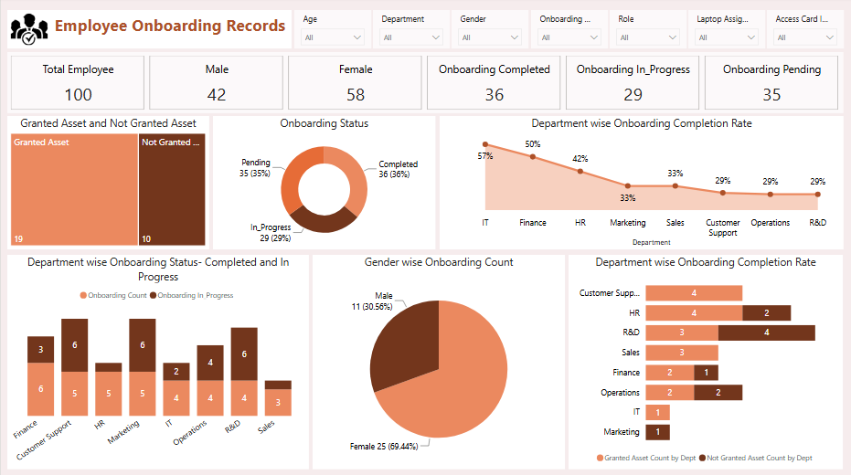

# Employee-Onboarding-Records

## Power BI Project
This project analyzes employee onboarding data to track onboarding status, asset allocation, and department-wise completion rates. An interactive dashboard was created to help stakeholders monitor onboarding progress, track asset distribution, and identify pending onboarding activities for better workforce management.

## Tools Covered : Advanced Excel, Power BI, Power Query

## Key Performance Indicators (KPIs):
• Total employee

• Total Male 

• Total Female

• Onboarding completed

• Onboarding in progress

• Onboarding pending

• Granted asset and non-granted asset 

• Onboarding status 

• Department-wise onboarding completion rate

• Department-wise onboarding status - completed and in progress 

• Gender-wise onboarding count 

• Department-wise onboarding completion rate.

## Dashboard Visualizations:
• Cards

• Treemap

• Donut Chart

• Line Chart

• Stacked Column Chart

• Pie Chart

• Stacked Bar Chart

## Interactive Features:

• Slicers

## Dashboard Preview:

